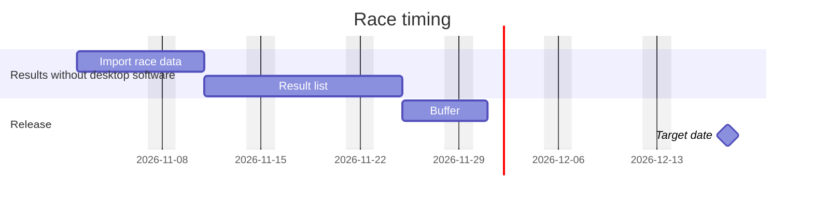

<!--
@license
Copyright (c) ggdna

Use of this source code is governed by terms that can be
found in the LICENSE file in the root of this package.
-->

# Leitfaden Zeitplan

Wie der Zeitplan eines Projekts entsteht: Die Anforderungen werden in
Tickets geschnitten, jedes Ticket wird geschätzt, und das Ergebnis wird als
Gantt-Diagramm gezeichnet.

## Wissen, was der Zeitplan ist <a id="know-what-the-schedule-is"></a>

- Eine Datei für das ganze Projekt im aktuellen Quartal:
  `pm/<lang>/<quarter>/charts/schedule.md`; ein neues Quartal übernimmt die
  Tickets, die nicht `done` sind, siehe den
  [Leitfaden PM-Repo](pm-repo-guide.md#start-a-quarter)
- Eine Prognose, kein Versprechen: Er zeigt, wann die Arbeit
  voraussichtlich fertig ist und ob ein Zieltermin hält
- Optional: Ein Projekt plant nur damit, wenn der Nutzer einen will
- Er beruht auf akzeptierten Anforderungen. Fehlen sie, führe zuerst
  `/gg-plan-requirements` aus

## Den Rahmen mit dem Nutzer festlegen <a id="set-the-frame-with-the-user"></a>

Stelle eine Frage nach der anderen und schlage jedes Mal einen Standard
vor:

- Zieltermin — optional. Ohne Zieltermin plane vom Start aus vorwärts und
  nenne das Enddatum, das sich ergibt
- Start — Standard: der nächste Arbeitstag
- Kapazität — wer am Projekt arbeitet und wie viele Tage pro Woche;
  Standard: `team/people.md` des aktuellen Quartals, falls das Repo sie hat
- Gesperrte Zeiten — Feiertage, Urlaub, andere Projekte
- Umfang — welche Ziele; Standard: alle aktiven

## Die Arbeit in Tickets schneiden <a id="cut-the-work-into-tickets"></a>

- Fasse die akzeptierten Anforderungen, die nicht `done` sind, zu Tickets
  zusammen. Ein Ticket ist ein Schritt, der für sich geliefert werden kann,
  idealerweise ein bis fünf Arbeitstage; teile größere
- Gib jedem geplanten Ticket einen Titel in englischem Kebab-Case, die
  Anforderungen, die es erfüllt, die Repos, die es voraussichtlich berührt,
  und die Tickets, auf die es wartet
- Ergänze die Arbeit, die keine Anforderung nennt, die der Plan aber
  braucht: Einrichtung, Migrationen, Releases, Dokumentation
- Verwende bestehende Ticket-Dateien mit ihren IDs weiter. Ein geplantes
  Ticket bekommt erst dann eine Ticket-Datei, wenn es wirklich geplant
  wird, siehe den [Leitfaden PM-Repo](pm-repo-guide.md#plan-a-ticket)

## Jedes Ticket schätzen <a id="estimate-each-ticket"></a>

- Schätze in Arbeitstagen einer Person: optimistisch `o`, wahrscheinlich
  `l`, pessimistisch `p`
- Erwartete Dauer: `(o + 4 * l + p) / 6`, aufgerundet auf halbe Tage
- Stütze die Zahlen auf die Anforderungen, die Code-Repos (ihre
  `index.md`) und abgeschlossene Tickets der Vergangenheit, und sage,
  worauf jede beruht
- Füge einen Puffer von 20 % der erwarteten Summe als eigenen Balken am
  Ende hinzu; verstecke Puffer nie in den Tickets
- Zeige dem Nutzer die Schätzungen, bevor du das Diagramm zeichnest. Seine
  Zahlen gelten

## Den Plan anordnen <a id="lay-out-the-plan"></a>

- Ordne die Tickets danach, worauf sie warten, dann nach Priorität: `must`
  vor `should` vor `could`
- Bearbeite Tickets nur dann parallel, wenn mehr als eine Person verfügbar
  ist
- Bei weniger als fünf Tagen pro Woche strecke jede Dauer entsprechend:
  Bei drei Tagen pro Woche werden aus fünf Arbeitstagen etwas mehr als acht
  Kalender-Arbeitstage
- Lass Wochenenden und gesperrte Zeiten aus
- Vergleiche das Ende mit dem Zieltermin. Passen die `must`-Tickets und der
  Puffer nicht hinein, sage es klar und biete Optionen an: `could`- und
  `should`-Tickets hinter den Termin verschieben, den Termin verschieben,
  Kapazität hinzufügen oder eine Anforderung streichen. Der Nutzer
  entscheidet; verkleinere nie Schätzungen, damit der Plan passt

## Den Zeitplan schreiben <a id="write-the-schedule"></a>

Verwende diese Vorlage:

````markdown
# Schedule

## Frame

- Target date: 2026-12-18
- Start: 2026-11-02
- Capacity: one developer, four days per week
- Forecast: done by 2026-11-30, 14 working days before the target date

## Gantt



## Tickets

| Ticket           | Requirements    | o / l / p  | Expected | After  |
| ---------------- | --------------- | ---------- | -------- | ------ |
| import-race-data | req-results-002 | 3 / 5 / 8  | 5.5 d    | —      |
| result-list      | req-results-001 | 5 / 7 / 12 | 7.5 d    | import |

## History

- 2026-10-19: first plan
````

- Ein Abschnitt pro Ziel, ein Balken pro Ticket. Die Balken-ID ist eine
  Kurzform des Ticket-Titels, damit `after` darauf verweisen kann
- Balkenlänge: die erwartete Dauer, auf die Kapazität gestreckt und auf
  ganze Tage aufgerundet
- Markiere abgeschlossene Tickets mit `done` und laufende mit `active`,
  z. B. `Import race data :done, import, 2026-11-02, 7d`
- Ein `milestone` am Zieltermin, falls es einen gibt

## Ihn lebendig halten <a id="keep-it-alive"></a>

- Aktualisiere den Zeitplan, wenn ein Ticket abgeschlossen ist: Markiere
  es mit `done` und vermerke, wie lange es wirklich gedauert hat
- Plane neu, wenn Schätzungen sich als falsch erweisen, Anforderungen sich
  ändern oder die Kapazität sich ändert, und aktualisiere die Prognose
- Schreibe den Verlauf nie um: Füge eine Zeile mit dem Datum hinzu, was
  sich geändert hat und warum
- Prüfe die Prognose bei jeder Quartalsplanung gegen den Zieltermin
