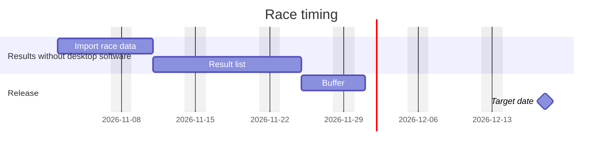

<!--
@license
Copyright (c) ggdna

Use of this source code is governed by terms that can be
found in the LICENSE file in the root of this package.
-->

# راهنمای زمان‌بندی

چگونه برنامهٔ زمانی یک پروژه ساخته می‌شود: نیازمندی‌ها به تیکت‌ها بریده
می‌شوند، هر تیکت تخمین زده می‌شود، و نتیجه به شکل نمودار گانت (Gantt) رسم
می‌شود.

## بدان زمان‌بندی چیست <a id="know-what-the-schedule-is"></a>

- یک فایل برای کل پروژه در فصل جاری:
  `pm/<lang>/<quarter>/charts/schedule.md`؛ فصل تازه تیکت‌هایی را که `done`
  نیستند تحویل می‌گیرد،
  [راهنمای مخزن PM](pm-repo-guide.md#start-a-quarter) را ببین
- یک پیش‌بینی است، نه یک قول: نشان می‌دهد کار احتمالاً کی تمام می‌شود و آیا
  تاریخ هدف پابرجا می‌ماند
- اختیاری: پروژه فقط وقتی با آن برنامه‌ریزی می‌کند که کاربر بخواهد
- بر نیازمندی‌های پذیرفته‌شده تکیه دارد. اگر نیستند، ابتدا
  `/gg-plan-requirements` را اجرا کن

## چارچوب را با کاربر تعیین کن <a id="set-the-frame-with-the-user"></a>

هر بار فقط یک پرسش بپرس و هر بار یک پیش‌فرض پیشنهاد کن:

- تاریخ هدف — اختیاری. بدون آن، از شروع به جلو برنامه‌ریزی کن و تاریخ
  پایانی را که به دست می‌آید گزارش کن
- شروع — پیش‌فرض: روز کاری بعدی
- ظرفیت — چه کسی روی پروژه کار می‌کند و چند روز در هفته؛ پیش‌فرض:
  `team/people.md` فصل جاری، اگر مخزن آن را دارد
- زمان‌های مسدود — تعطیلات، مرخصی‌ها، پروژه‌های دیگر
- دامنه — کدام هدف‌ها؛ پیش‌فرض: همهٔ هدف‌های فعال

## کار را به تیکت‌ها ببُر <a id="cut-the-work-into-tickets"></a>

- نیازمندی‌های پذیرفته‌شده‌ای را که `done` نیستند در تیکت‌ها گروه‌بندی کن.
  هر تیکت یک گام است که به‌تنهایی قابل تحویل باشد، در حالت ایده‌آل یک تا
  پنج روز کاری؛ تیکت‌های بزرگ‌تر را تقسیم کن
- به هر تیکت برنامه‌ریزی‌شده یک عنوان به انگلیسی و به شکل kebab case بده،
  نیازمندی‌هایی که برآورده می‌کند، مخزن‌هایی که احتمالاً به آن‌ها دست می‌زند
  و تیکت‌هایی که منتظرشان است
- کاری را اضافه کن که هیچ نیازمندی‌ای نام نمی‌برد ولی برنامه به آن نیاز
  دارد: راه‌اندازی، مهاجرت‌ها، انتشارها، مستندسازی
- فایل‌های تیکت موجود را با شناسه‌هایشان دوباره به کار ببر. یک تیکت
  برنامه‌ریزی‌شده فقط وقتی فایل تیکت می‌گیرد که واقعاً برنامه‌ریزی شود،
  [راهنمای مخزن PM](pm-repo-guide.md#plan-a-ticket) را ببین

## هر تیکت را تخمین بزن <a id="estimate-each-ticket"></a>

- بر حسب روز کاری یک نفر تخمین بزن: خوش‌بینانه `o`، محتمل `l`،
  بدبینانه `p`
- مدت مورد انتظار: `(o + 4 * l + p) / 6`، گرد شده به بالا تا نیم‌روز
- عددها را بر پایهٔ نیازمندی‌ها، مخزن‌های کد (`index.md` آن‌ها) و
  تیکت‌های تمام‌شدهٔ گذشته بگذار، و بگو هر کدام بر چه تکیه دارد
- یک ذخیرهٔ زمانی (buffer) برابر 20 % مجموع مورد انتظار را به‌عنوان یک میلهٔ
  جداگانه در پایان اضافه کن؛ هرگز ذخیره را درون تیکت‌ها پنهان نکن
- پیش از رسم نمودار، تخمین‌ها را به کاربر نشان بده. عددهای او معتبرند

## برنامه را بچین <a id="lay-out-the-plan"></a>

- تیکت‌ها را بر اساس آنچه منتظرش هستند مرتب کن، سپس بر اساس اولویت: `must`
  پیش از `should` پیش از `could`
- تیکت‌ها را فقط وقتی موازی پیش ببر که بیش از یک نفر در دسترس باشد
- با کمتر از پنج روز در هفته، هر مدت را به همان نسبت بکش: با سه روز در
  هفته، پنج روز کاری کمی بیش از هشت روز کاری تقویمی می‌شود
- آخر هفته‌ها و زمان‌های مسدود را کنار بگذار
- پایان را با تاریخ هدف مقایسه کن. اگر تیکت‌های `must` و ذخیرهٔ زمانی جا
  نمی‌شوند، صریح بگو و گزینه‌ها پیشنهاد بده: تیکت‌های `could` و `should`
  را به پس از تاریخ ببر، تاریخ را جابه‌جا کن، ظرفیت اضافه کن، یا یک
  نیازمندی را حذف کن. کاربر تصمیم می‌گیرد؛ هرگز تخمین‌ها را کوچک نکن تا
  برنامه جا شود

## زمان‌بندی را بنویس <a id="write-the-schedule"></a>

از این قالب استفاده کن:

````markdown
# Schedule

## Frame

- Target date: 2026-12-18
- Start: 2026-11-02
- Capacity: one developer, four days per week
- Forecast: done by 2026-11-30, 14 working days before the target date

## Gantt



## Tickets

| Ticket           | Requirements    | o / l / p  | Expected | After  |
| ---------------- | --------------- | ---------- | -------- | ------ |
| import-race-data | req-results-002 | 3 / 5 / 8  | 5.5 d    | —      |
| result-list      | req-results-001 | 5 / 7 / 12 | 7.5 d    | import |

## History

- 2026-10-19: first plan
````

- برای هر هدف یک بخش، برای هر تیکت یک میله. شناسهٔ میله شکل کوتاه‌شدهٔ
  عنوان تیکت است، تا `after` بتواند به آن ارجاع دهد
- طول میله: مدت مورد انتظار، کشیده‌شده به اندازهٔ ظرفیت و گرد شده به بالا
  تا روز کامل
- تیکت‌های تمام‌شده را با `done` و تیکت‌های در جریان را با `active` علامت
  بزن، مثلاً `Import race data :done, import, 2026-11-02, 7d`
- یک `milestone` در تاریخ هدف، اگر تاریخ هدفی هست

## آن را زنده نگه دار <a id="keep-it-alive"></a>

- وقتی تیکتی تمام شد زمان‌بندی را به‌روز کن: آن را `done` علامت بزن و
  یادداشت کن واقعاً چقدر طول کشید
- وقتی تخمین‌ها نادرست از آب درآمدند، نیازمندی‌ها یا ظرفیت تغییر کردند،
  دوباره برنامه‌ریزی کن و پیش‌بینی را به‌روز کن
- هرگز تاریخچه را بازنویسی نکن: یک سطر با تاریخ، آنچه تغییر کرد و دلیلش
  اضافه کن
- در هر برنامه‌ریزی فصلی پیش‌بینی را با تاریخ هدف مقایسه کن
